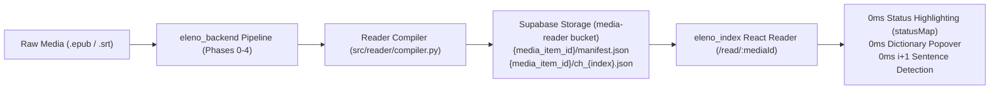

# Eleno Pre-Tokenized Reader (`.eleno.json`) — Implementation Plan

> [!IMPORTANT]
> **Purpose of This Document**
> This document is a complete, self-contained engineering specification designed so any AI coding agent or developer can implement the **Eleno Native Reader** across [`eleno_backend`](file:///c:/Users/drjopari/Documents/eleno_backend) and [`eleno_index`](file:///c:/Users/drjopari/Documents/eleno_index) without requiring `epub.js`, `<iframe>` DOM injection, or runtime NLP offset matching.

---

## 1. Architectural Overview & Why We Drop Raw `epub.js`

In the legacy prototype (`Eleno_v2/catalogue-web`), the reader loaded a raw `.epub` into an `epub.js` `<iframe>` and attempted to fuzzy-match DOM `<p>` nodes against a separate JSON token analysis file at runtime (`sourceMapping.ts`, `chapterAnnotations.ts`), splitting DOM `Range` nodes to insert `<span class="eleno-word">` and `<ruby><rt>` elements. That caused iframe style isolation bugs, `epubcfi(...)` pagination drift, and complex DOM mutation overhead.

In **`eleno_backend`** + **`eleno_index`**, we already run every book (`.epub`) and subtitle transcript (`.srt`/`.vtt`) through our deterministic 5-phase Spanish pipeline (`spaCy es_core_news_lg` + 8-stage `LocalLexicon` resolver + `KaikkiDefinitionResolver`). By emitting a **Pre-Tokenized Reader Artifact** during ingestion, the frontend reader becomes a pure, `0ms` React component tree.



---

## 2. The `.eleno.json` Data Format Specification (Schema v1)

To keep chapter loads instantaneous (`< 30 KB` per chapter gzipped) while avoiding repeating UUIDs and dictionary glosses for every token occurrence, the reader format splits into:
1. **`manifest.json`**: Book/Season metadata, table of contents (`chapters`), and the deduplicated **`lexicon` array** for the media item.
2. **`ch_{chapter_index}.json`**: The pre-tokenized blocks, sentences, and token tuples for a single chapter or episode. *(For books under 100k words, all chapters may also be bundled into a single `book.eleno.json` if desired, or fetched per-chapter with 1-chapter ahead prefetching).*

### 2.1 `manifest.json` Schema

```ts
export interface ElenoReaderManifest {
  schema_version: 1;
  media_item_id: string;        // UUID from public.media_item
  title: string;
  creator: string;
  type: "book" | "movie" | "tv_show";
  language: "es";
  total_chapters: number;
  chapters: {
    index: number;              // 1-based chapter/episode index (matches media_chapter_metrics)
    title: string;              // e.g. "Capítulo 1" or "1x01: Bienvenidos"
    token_count: number;
    block_count: number;
  }[];
  /**
   * Deduplicated array of all verified canonical words in this media item.
   * Tokens inside chapters reference this array by 0-based integer index (lex_idx).
   */
  lexicon: ElenoLexiconEntry[];
}

export interface ElenoLexiconEntry {
  id: string;                   // UUID from public.canonical_lexical_entity.id
  lemma: string;                // e.g. "orgulloso"
  pos: string;                  // UPOS tag: "NOUN" | "VERB" | "ADJ" | "ADV" | ...
  cefr: string;                 // "A1" | "A2" | "B1" | "B2" | "C1" | "C2"
  rank: number | null;          // TubeLex rank (e.g. 2415)
  ipa: string | null;           // e.g. "/oɾɡuˈʎoso/"
  hint: string | null;          // Compact <=36 char gloss for <ruby><rt> above-word hint
  definitions: string[];        // Full numbered Kaikki English glosses
}
```

### 2.2 `ch_{index}.json` (Chapter / Episode Payload) Schema

```ts
export interface ElenoReaderChapter {
  schema_version: 1;
  media_item_id: string;
  chapter_index: number;
  chapter_title: string;
  blocks: ElenoReaderBlock[];
}

export interface ElenoReaderBlock {
  /**
   * 'h1' | 'h2' | 'h3' = Headings
   * 'p' = Standard prose paragraph
   * 'quote' = Blockquote / letter
   * 'cue' = Subtitle dialogue turn (includes time_ms)
   */
  type: "h1" | "h2" | "h3" | "p" | "quote" | "cue";
  time_ms?: [number, number];   // Optional [start_ms, end_ms] for .srt/.vtt subtitle cues
  /**
   * Each block is an array of sentences.
   * Each sentence is an array of ElenoTokens.
   */
  sentences: ElenoToken[][];
}

/**
 * A token is EITHER:
 * - A plain string: whitespace, punctuation, numbers, or untrackable proper nouns (e.g. "El ", ", ", "Harry")
 * - A 2-tuple [surface_form, lexicon_index]: a trackable canonical word
 *   where lexicon_index is the 0-based index into manifest.lexicon[].
 */
export type ElenoToken = string | [surface: string, lexIdx: number];
```

### 2.3 Concrete JSON Example
```json
{
  "type": "p",
  "sentences": [
    [
      "El ",
      ["señor", 0],
      " y la ",
      ["señora", 1],
      " Dursley, que ",
      ["vivían", 22],
      " en el ",
      ["número", 31],
      " 4 de Privet Drive, ",
      ["estaban", 2],
      " ",
      ["orgullosos", 3],
      " de ",
      ["decir", 4],
      " que ",
      ["eran", 19],
      " ",
      ["muy", 8],
      " ",
      ["normales", 5],
      "."
    ]
  ]
}
```

---

## 3. Phase 1 — Backend Implementation (`eleno_backend`)

> [!NOTE]
> Follow all rules in [`eleno_backend/AGENTS.md`](file:///c:/Users/drjopari/Documents/eleno_backend/AGENTS.md):
> - Open `data/lexicon_es.db` and `data/sources/kaikki/es-en-lemmas-v1.sqlite3` strictly in read-only mode (`mode=ro`).
> - Never modify existing SQL migrations in-place; create a new timestamped migration.

### Step 1.1: Preserve Paragraph Structure in Loaders
Currently, `HTMLTextExtractor` in `src/loaders/html_text_extractor.py` joins paragraphs with `\n\n`.
- Ensure `DocumentChunk.text` preserves `\n\n` paragraph breaks (and heading markers or block types) so the compiler can split each chapter chunk into paragraphs (`blocks`) before or during `spaCy` processing.
- In `SubtitleLoader`, optionally retain `(start_ms, end_ms, cue_text)` in `DocumentChunk.metadata["cues"]` so subtitle chapters emit `"type": "cue"` blocks with `"time_ms": [start_ms, end_ms]`.

### Step 1.2: Create `src/reader/compiler.py` (`ReaderArtifactCompiler`)
Create a modular compiler class that takes:
- `media_item_id: str`
- `metadata: DocumentMetadata`
- `entities: List[CanonicalEntity]` (already resolved with `id`, `lemma`, `pos`, `rankings`, `pronunciations`, and `definitions`)
- Per-chapter analyzed `spacy_doc` + resolved `(surface, lemma, pos) -> canonical_id` map.

**How `ReaderArtifactCompiler` builds each chapter**:
1. **Build `lexicon` list & `canonical_key_to_idx` map**:
   - Sort `entities` deterministically (by frequency desc, then lemma asc).
   - For each entity, compute `hint = compact_gloss(entity.definitions[0])` (strip parenthetical prefix, take first clause before `;` or `,`, truncate to `<= 32` chars).
   - Emit `ElenoLexiconEntry` at index `idx`.
2. **Build `blocks` -> `sentences` -> `tokens` from `spacy_doc`**:
   - Split chapter into paragraphs by `\n\n`.
   - For each paragraph (`spacy.tokens.Span` or `Doc` sentences):
     - For each `sent` in `paragraph.sents`:
       - Walk tokens (`tok`) in `sent`:
         - If `tok` resolves to a trackable `CanonicalEntity` (`pos not in ("PROPN", "PUNCT", "NUM", "SYM")`):
           - Flush any accumulated plain string buffer.
           - Append `[tok.text, lex_idx]`.
           - If `tok.whitespace_`: append `tok.whitespace_` to the plain string buffer.
         - Else (punctuation, numbers, proper nouns):
           - Append `tok.text_with_ws` to the plain string buffer (merging adjacent plain strings so `", "` or `" de Privet Drive, "` is a single string item!).

### Step 1.3: Supabase Storage Bucket & Database Migration
Create a new sequentially timestamped SQL migration `supabase/migrations/YYYYMMDDHHMMSS_create_reader_storage_and_progress.sql`:
1. **Storage Bucket (`media-reader`)**:
   - Public read bucket storing:
     - `{media_item_id}/manifest.json`
     - `{media_item_id}/ch_1.json`, `{media_item_id}/ch_2.json`, ...
2. **Column on `media_item`**:
   - `ALTER TABLE media_item ADD COLUMN IF NOT EXISTS has_reader_content BOOLEAN NOT NULL DEFAULT false;`
3. **Reading Progress & Bookmarks Table (`user_reading_progress`)**:
   ```sql
   CREATE TABLE IF NOT EXISTS user_reading_progress (
       user_id UUID NOT NULL REFERENCES auth.users(id) ON DELETE CASCADE,
       media_item_id UUID NOT NULL REFERENCES media_item(id) ON DELETE CASCADE,
       chapter_index INTEGER NOT NULL DEFAULT 1,
       block_index INTEGER NOT NULL DEFAULT 0,
       token_index INTEGER NOT NULL DEFAULT 0,
       percentage NUMERIC(5, 2) NOT NULL DEFAULT 0,
       bookmarks JSONB NOT NULL DEFAULT '[]'::jsonb,
       updated_at TIMESTAMPTZ NOT NULL DEFAULT now(),
       PRIMARY KEY (user_id, media_item_id)
   );
   ```
   - Notice how clean `(chapter_index, block_index, token_index)` is compared to `epubcfi(...)`: restoring a reading position or bookmark is a single `document.querySelector('[data-block="42"]')` scroll!

---

## 4. Phase 2 — Frontend Implementation (`eleno_index`)

> [!CAUTION]
> **Strict `eleno_index` Rules ([`eleno_index/AGENTS.md`](file:///c:/Users/drjopari/Documents/eleno_index/AGENTS.md))**:
> 1. **Every single file in `src/` MUST be strictly `<= 150` lines.**
> 2. **Zero `@supabase/supabase-js` imports outside `src/api/*.api.ts`.**
> 3. **All `BIGINT` / `NUMERIC` fields coerced via `Number()` in `src/api/normalizers.ts`.**

### 4.1 Planned File Breakdown (All Strictly `<= 150` Lines)

```
src/
├── types/
│   └── reader.types.ts              # (~65 lines) ElenoReaderManifest, ElenoReaderChapter, ElenoLexiconEntry, ReadingProgress
├── api/
│   └── reader.api.ts                # (~95 lines) Fetch manifest.json & ch_{n}.json from Supabase Storage + save/load user_reading_progress
├── lib/
│   └── readerCache.ts               # (~70 lines) In-memory + IndexedDB/localStorage chapter cache + next-chapter prefetcher
├── hooks/
│   └── useReaderSession.ts          # (~120 lines) Manages active chapter, block scroll position, i+1 toggle, ruby hints toggle, & word selection
├── components/
│   └── reader/
│       ├── ReaderTopBar.tsx         # (~95 lines) Back to Media, Chapter selector dropdown, Progress %, Ruby Hints / i+1 / Theme toggles
│       ├── ReaderCanvas.tsx         # (~110 lines) Renders blocks & sentences; highlights Unknown, Learning (#B8FF01), Known, and i+1 sentences
│       ├── ReaderTokenSpan.tsx      # (~75 lines) Individual word <span> or <ruby><rt> with 0ms status class & click handler
│       └── ReaderWordDock.tsx       # (~125 lines) Side/bottom inspector dock showing Lemma, IPA, Rank, CEFR, Kaikki definitions, Sentence context, & Learn/Known buttons
└── pages/
    └── ReaderPage.tsx               # (~90 lines) Route /read/:mediaId wiring useReaderSession, ReaderTopBar, ReaderCanvas, and ReaderWordDock
```

### 4.2 Highlighting & Pedagogical Modes in `ReaderCanvas.tsx`
Because every token is `[surface, lexIdx]` and `entry = manifest.lexicon[lexIdx]`, `ReaderCanvas` supports 4 instant visual layers driven directly by `statusMap[entry.id]`:
1. **Word State Highlighting (`0ms`)**:
   - **`Known`** (`status === "known"`): Clean default ink (`#111111`), zero visual noise so you read fluently.
   - **`Learning`** (`status === "learning"`): Crisp `#B8FF01` (Volt) highlight pill or underline so you notice words you are actively acquiring every time they appear in the story.
   - **`Unknown`** (`!status`): Subtle dotted underline (or rank-tiered tint for top-1k/5k high-value words).
2. **Above-Word `<ruby>` Glosses Toggle**:
   - When enabled, any `Learning` (or `Unknown`) word automatically renders `<ruby>{surface}<rt>{entry.hint}</rt></ruby>` using `entry.hint` right from `manifest.lexicon` — zero network requests!
3. **`i+1` Sentence Highlighting**:
   - A pure helper `isSentenceIPlusOne(sentence, lexicon, statusMap)` checks if a sentence has **exactly 1** non-known trackable token:
     ```ts
     export function isSentenceIPlusOne(
       sentence: ElenoToken[],
       lexicon: ElenoLexiconEntry[],
       statusMap: Record<string, UserVocabStatus>
     ): boolean {
       let unknownCount = 0;
       for (const tok of sentence) {
         if (typeof tok === "string") continue;
         const entry = lexicon[tok[1]];
         if (entry && statusMap[entry.id] !== "known") {
           unknownCount++;
           if (unknownCount > 1) return false;
         }
       }
       return unknownCount === 1;
     }
     ```
   - When the user clicks **"Mark Known"** on a word in `ReaderWordDock`, `statusMap` updates in `0ms`, and the surrounding sentences immediately re-evaluate their `i+1` state!

---

## 5. Step-by-Step Execution Checklist for Any AI Agent

1. **Step 1 (Database & Storage)**:
   - Write and ask the user to run `supabase/migrations/YYYYMMDDHHMMSS_create_reader_storage_and_progress.sql` to create the `media-reader` storage bucket, `media_item.has_reader_content` column, and `user_reading_progress` table.
2. **Step 2 (Backend Compiler)**:
   - Implement `src/reader/compiler.py` (`ReaderArtifactCompiler`) and integrate it into `TextIngestionPipeline.process_document` and `SupabaseLexicalClient.sync_document` so every ingested book or TV season uploads `{media_item_id}/manifest.json` and `ch_{n}.json`.
   - Create `scripts/compile_existing_reader.py` to compile `.eleno.json` artifacts for already-ingested books/series.
3. **Step 3 (Frontend Reader Modules)**:
   - Create the 9 modular files listed in Section 4.1 (verifying each file is strictly `<= 150` lines).
   - Add a **"Read in Index →"** button to `InspectorSpecHeader.tsx` and `CatalogueCard.tsx` when `item.has_reader_content` is true, linking to `/read/:mediaId`.
4. **Step 4 (Verification)**:
   - Run `npm run build` (`tsc && vite build`) and run the PowerShell line-count check to verify zero files exceed `150` lines.
